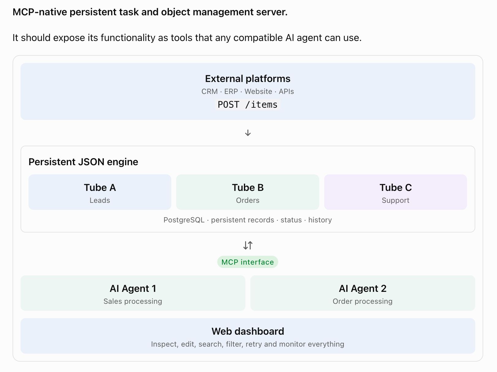

# MCPocket

**Persistent storage and coordination for AI agents.**
*Your agents. Your data. One shared workspace.* — [mcpocket.io](https://mcpocket.io)

- Persistent JSON collections
- Hierarchical folders and tubes
- MCP-native agent access
- REST API integrations
- Real-time monitoring dashboard

Folders organise **tubes**; tubes hold JSON **items** that agents claim,
heartbeat and complete under a lease. Everything — web dashboard, REST API
and MCP server (Streamable HTTP, legacy SSE, stdio proxy) — runs in one
Next.js process sharing the same application services, so the rules,
permissions and audit history are identical on every surface.



## Repository layout

MCPocket is open source under the [Apache License 2.0](LICENSE). This
repository is the self-hosted edition; MCPocket Cloud is built from the same
core in a separate, private repository.

| Path | What it is |
|---|---|
| [`packages/core`](packages/core) | `@mcpocket/core`: domain, storage drivers, services, REST handlers, MCP server and tools. No Next.js or React |
| `app/`, `components/`, `lib/` | The self-hosted Next.js app: dashboard, API routes, admin login |
| `bin/`, `scripts/`, `mock/` | stdio proxy, seed and migration scripts, demo data |

npm workspaces link `packages/core` into the app; `npm install` at the root
sets everything up. App code imports the core as `@mcpocket/core/...`.

## Quick start (Docker Compose)

Requirements: Docker with Compose v2.

```bash
git clone <repo-url> mcpocket && cd mcpocket
cp .env.example .env
# edit .env — at least (paste literal values; .env does not run commands):
#   MCPOCKET_ADMIN_PASSWORD=<strong password>               (required)
#   MCPOCKET_API_KEYS=ops:<output of: openssl rand -hex 24>  (REST / MCP clients)
#   MCPOCKET_SESSION_SECRET=<output of: openssl rand -base64 32>
docker compose up -d --build
docker compose ps            # STATUS shows "(healthy)" after a few seconds
```

Then open <http://localhost:3000> and sign in at `/login` with
`MCPOCKET_ADMIN_USERNAME` (default `admin`) / `MCPOCKET_ADMIN_PASSWORD`.
Check the API with the key from `.env`:

```bash
curl http://localhost:3000/api/health                       # {"status":"ok",...} (no auth)
curl -H "Authorization: Bearer <secret>" http://localhost:3000/api/folders/tree
```

What you get:

| | |
|---|---|
| Image | `mcpocket:latest` (`MCPOCKET_IMAGE_TAG`), multi-stage build of the Next.js standalone server on `node:22-alpine`, runs as the non-root `node` user |
| Service | `mcpocket` — dashboard, REST (`/api/*`) and MCP (`/api/mcp`, `/api/mcp/sse`) on one port (`MCPOCKET_PORT`, default 3000) |
| Volume | `mcpocket-data` mounted at `/app/data` (all data: JSON collection files, or `mcpocket.db` with `STORAGE_DRIVER=sqlite`) |
| Seed | with `MCPOCKET_SEED_ON_FIRST_START=true` (as in `.env.example`) an **empty** volume is seeded from `mock/seed.json` on first start; existing data is never touched. Set it to `false` to start empty |
| Health | `GET /api/health` (unauthenticated: `200 {"status":"ok","checks":{"storage":"ok"}}` or `503`, no data) — used by the Compose / image `HEALTHCHECK` |
| Workers | lease sweeper + webhook dispatcher start inside the same process (`instrumentation.ts`) |

**Initial admin account.** There is one dashboard admin, defined by
`MCPOCKET_ADMIN_USERNAME` / `MCPOCKET_ADMIN_PASSWORD` in `.env` — no setup
wizard, nothing stored in `data/`. Compose refuses to start while the
password is empty. To change it, edit `.env` and `docker compose up -d`
(existing sessions are invalidated). `.env.example` sets
`MCPOCKET_COOKIE_SECURE=false` so sign-in works over plain
`http://<host>:3000`; put MCPocket behind an HTTPS reverse proxy and set it
to `true` for anything beyond a local/trusted network. API keys: env keys
from `MCPOCKET_API_KEYS`, or create scoped keys on the dashboard **Access**
page.

**Configuration.** Every variable is documented in
[`.env.example`](.env.example) (storage, seeding, admin, API keys/roles,
rate limits, leases/retries/sweeper, agent monitoring, webhooks). Details per
feature are in the sections below.

**Operations.**

```bash
docker compose logs -f mcpocket          # logs (seeding, sweeper, dispatcher)
git pull && docker compose up -d --build   # upgrade — data stays on the volume
docker compose down                      # stop (keeps the volume)
docker compose down -v                   # stop AND delete all data
```

- **Run exactly one replica.** Writes are serialised by an in-process lock
  (both storage drivers), and the sweeper/dispatcher/rate limiter/SSE sessions are in memory:
  never scale the service or point two containers at the same volume.
- The container needs **outbound HTTP(S)** to your webhook URLs.
- A bind mount instead of the named volume (`./data:/app/data`) works too;
  the directory must be writable by uid 1000 (`sudo chown 1000:1000 data`).

### Prebuilt image (GHCR)

Instead of building locally you can pull the published image
`ghcr.io/romanbwrk/mcpocket.io` (`linux/amd64` and `linux/arm64`):

| Tag | Points to |
|---|---|
| `latest` | the newest build of `main` or the newest `v*` release (pre-releases excluded) |
| `1.2.3`, `1.2` | a `v1.2.3` release / the newest patch of `1.2` |
| `main`, `sha-<short>` | the newest build of `main` / one exact commit |

Compose uses a local `mcpocket:<MCPOCKET_IMAGE_TAG>` image when it exists and
only builds when it is missing, so tag the pulled image and start without
`--build`:

```bash
docker pull ghcr.io/romanbwrk/mcpocket.io:latest
docker tag ghcr.io/romanbwrk/mcpocket.io:latest mcpocket:latest
docker compose up -d                     # upgrade: pull + tag again, then up -d
```

Or run it without Compose:

```bash
docker run -d --name mcpocket --restart unless-stopped -p 3000:3000 \
  --env-file .env -e STORAGE_DRIVER=sqlite \
  -v mcpocket-data:/app/data ghcr.io/romanbwrk/mcpocket.io:latest
```

(The image defaults to `STORAGE_DRIVER=json`; `-e STORAGE_DRIVER=sqlite`
matches what Compose uses.)

Images are published by the manual
[`Docker image`](.github/workflows/docker.yml) workflow: run it from the
Actions tab (or `gh workflow run docker.yml --ref main` / `--ref v1.2.3`).
Only runs off `main` or a `v*` tag publish. A new GHCR package is private;
make it public in the package settings to allow anonymous pulls.

### Storage drivers

`STORAGE_DRIVER` selects where data lives. `json` and `sqlite` run inside the
one Node process — no database container; `mongo` uses an external MongoDB:

| Driver | Data | Notes |
|---|---|---|
| `json` (default) | one file per collection in `DATA_DIR` | everything in memory; each write rewrites the touched files. Simple to read/diff; best for small datasets |
| `sqlite` | one file, `SQLITE_FILE` (default `DATA_DIR/mcpocket.db`) | built-in `node:sqlite` (Node ≥ 22.13, no native module), WAL + `synchronous=FULL`; reads from disk with indexes, writes touch only changed rows. Use for larger item/history volumes |
| `mongo` | workspace `MCPOCKET_WORKSPACE` of database `MONGODB_DB` (default `mcpocket`) at `MONGODB_URI` | one collection per entity, documents are the entities themselves (plus a `workspace` tenant field and `_seq`/`_createdMs` sort fields). Works on a standalone server (MongoDB ≥ 5); on a replica set each commit is a MongoDB transaction (all-or-nothing). Like the other drivers it assumes one MCPocket process writes to a workspace |

**One database and one bucket, many workspaces.** `MCPOCKET_WORKSPACE`
(default `MCPOCKET_SSO_WORKSPACE`; slug: letters, digits, `_`, `.`, `-`)
names the tenant an instance serves. Every Mongo document carries a
`workspace` field and every query is scoped to it (`{workspace, id}` is
unique, so workspaces may reuse entity ids; without a workspace the Mongo
driver uses `default`), and media objects live under
`<MCPOCKET_MEDIA_PREFIX><workspace>/`, so many MCPocket instances — one per
workspace, as on MCPocket Cloud — can share one database and one bucket.

**Cloud mode** (`MCPOCKET_MULTI_WORKSPACE=true`, needs `mongo`): instead of
one instance per workspace, ONE instance serves every workspace and each
request acts in the workspace of its credential:

| Credential | Workspace |
|---|---|
| Dashboard SSO session | the sign-in token's `ws` claim (required; leave `MCPOCKET_SSO_WORKSPACE` empty) |
| OAuth access token | the grant's `ws` |
| Managed API key | the workspace it was created in |
| Password admin, env API keys | `MCPOCKET_WORKSPACE` (else `default`) |

Storage, media prefix, live dashboard events, signed upload links and media
access are all scoped to that workspace; the lease sweeper and webhook
dispatcher run over every workspace. With `MCPOCKET_SEED_ON_FIRST_START`, a
workspace is seeded the first time it is used. Try it locally:
`npm run sso:token -- you@example.com --ws acme`.

With `mongo`, `npm run seed` and `MCPOCKET_SEED_ON_FIRST_START` (fills an
empty workspace) work as for the other drivers but only touch the instance's
own workspace, and a running server sees a re-seed at once. The Mongo tests run against a real server when
`MONGODB_TEST_URI` is set (each test uses a throwaway `mcpocket_test_*`
database).

#### Production with MongoDB

`docker-compose.prod.yml` runs the app together with MongoDB 8 as a
single-node replica set, so every commit is a MongoDB transaction:

```bash
# .env: MCPOCKET_ADMIN_PASSWORD, MONGO_ROOT_PASSWORD, MONGO_APP_PASSWORD (+ app secrets)
docker compose -f docker-compose.prod.yml up -d --build   # or: make up PROD=1
```

The app connects with its own `readWrite` account (created on first start by
`docker/mongo/initdb.d/01-app-user.js`), never the root user. MongoDB is not
published publicly, only on `127.0.0.1:${MONGO_PORT:-27017}` for admin over an
SSH tunnel (use `?directConnection=true` from there). Data lives in the
`mongo-data` / `mongo-config` volumes; the header of the compose file has a
`mongodump` backup command.

Data written before workspaces existed has no `workspace` field and is
invisible to the app. Assign it to a workspace once (mongosh, as a
`readWrite` user of the database), then restart:

```js
for (const c of ["folders", "tubes", "items", "history", "api_keys", "audit", "webhooks", "webhook_deliveries"])
  db[c].updateMany({ workspace: { $exists: false } }, { $set: { workspace: "default" } })
db.counters.find({ _id: { $not: /:/ } }).forEach((c) => {
  db.counters.insertOne({ _id: `default:${c._id}`, seq: c.seq }); db.counters.deleteOne({ _id: c._id })
})
```

Switch an existing JSON dataset to SQLite (the JSON files are left as they
are):

```bash
# stop the server first
npm run migrate:sqlite                 # copies DATA_DIR/*.json → mcpocket.db (refuses a non-empty DB; --force to replace)
STORAGE_DRIVER=sqlite npm run dev      # or set STORAGE_DRIVER=sqlite in .env / docker-compose.yml
```

In Docker set `STORAGE_DRIVER: sqlite` in `docker-compose.yml`; a fresh
volume is seeded into the database on first start, like the JSON driver. To
move an existing volume, copy its data out (`docker compose cp
mcpocket:/app/data ./data-export`), run `DATA_DIR=./data-export npm run
migrate:sqlite` on the host, copy `data-export/mcpocket.db` back in, then
switch the driver. Node prints a one-time
`ExperimentalWarning: SQLite is an experimental feature` at startup; it is
harmless.

### Backup & restore

**SQLite:** the database is `mcpocket.db` plus its `-wal`/`-shm` files —
copy all three with the app stopped (same commands as below), or take a live
snapshot with `sqlite3 data/mcpocket.db ".backup backup.db"`.

**JSON:** all state lives in the data directory (`folders.json`, `tubes.json`,
`items.json`, `history.json`, `api-keys.json`, `audit.json`,
`webhooks.json`, `webhook-deliveries.json`). Files are replaced atomically
(write temp + rename), but stop the app for a consistent snapshot across
files:

```bash
# backup
docker compose stop mcpocket
docker compose cp mcpocket:/app/data ./backup-$(date +%F)
docker compose start mcpocket

# restore (replaces the current data)
docker compose stop mcpocket
docker compose cp ./backup-2026-01-31/. mcpocket:/app/data/
docker compose start mcpocket
```

(`docker compose cp` works on stopped containers. Without Docker: copy
`DATA_DIR`, default `./data`, while the server is stopped.) To reset to the
demo data, stop the app, empty the volume (`docker compose down -v`) and
start again with `MCPOCKET_SEED_ON_FIRST_START=true`.

## Local development

```bash
npm install
cp .env.example .env.local     # set MCPOCKET_ADMIN_PASSWORD and MCPOCKET_API_KEYS
npm run seed                   # (re)seed storage from mock/seed.json — JSON: restart the server afterwards; SQLite: live
npm run dev                    # http://localhost:3000
npm test && npm run typecheck && npm run lint
```

`npm run build && node .next/standalone/server.js` runs the production
bundle (copy `public/` and `.next/static/` next to it first, as the
Dockerfile does). `npm run build:stdio` bundles the stdio proxy into a
single dependency-free file (`dist/mcpocket-stdio.mjs`, shipped in the image
as `bin/mcpocket-stdio.mjs`).

## Dashboard (admin login)

The web dashboard lives at `/dashboard` (landing page at `/`, sign-in at
`/login`). It is protected by a single admin account configured through the
environment; the browser only receives an httpOnly, HMAC-signed session
cookie (`mcpocket_session`) — never an API key. The dashboard calls the same
application services as REST/MCP, so audit history records it as
`user:<username>`.

| Variable | Default | Purpose |
|---|---|---|
| `MCPOCKET_ADMIN_USERNAME` | `admin` | Admin login name |
| `MCPOCKET_ADMIN_PASSWORD` | — (required) | Admin password. Without it the login page shows setup instructions and nobody can sign in |
| `MCPOCKET_SESSION_SECRET` | derived from the password | Key for signing session cookies (`openssl rand -base64 32`). Set it explicitly in production |
| `MCPOCKET_SESSION_TTL_HOURS` | `12` | Session lifetime |
| `MCPOCKET_COOKIE_SECURE` | `true` in production | Set `false` only when serving production over plain HTTP |
| `MCPOCKET_AGENT_ONLINE_SECONDS` | `120` | Agents page: an agent is *online* if its last heartbeat (or any other call) is at most this old |
| `MCPOCKET_AGENT_STALE_SECONDS` | `600` | Agents page: older than online but at most this old = *idle*; older (or never seen) = *stale*. Must exceed the online threshold |
| `MCPOCKET_LOGIN_MAX_ATTEMPTS` | `10` | Failed logins allowed per client IP (first `X-Forwarded-For` hop) and window; `0` disables throttling |
| `MCPOCKET_LOGIN_WINDOW_SECONDS` | `900` | Login throttling window; a successful login resets the client's counter |

Changing the username, password or session secret invalidates existing
sessions. Example `.env.local`:

```bash
MCPOCKET_ADMIN_USERNAME=admin
MCPOCKET_ADMIN_PASSWORD=change-me
MCPOCKET_SESSION_SECRET=<output of: openssl rand -base64 32>
```

### SSO token login (optional)

A trusted external system — MCPocket Cloud's control plane, or your own
identity provider — can sign a person into the dashboard without a password.
It sends the browser to `/auth/sso?token=<jwt>` (or POSTs a form with a
`token` field); `next=/dashboard/...` optionally picks the landing page. A
valid token starts a normal dashboard session (same cookie, same TTL) with the
person's email as username, so audit history records `user:<email>`. SSO
users act as administrators, like the password account. Password login keeps
working. The feature is off — `/auth/sso` returns 404 — unless
`MCPOCKET_SSO_SECRET` is set.

| Variable | Default | Purpose |
|---|---|---|
| `MCPOCKET_SSO_SECRET` | — (SSO off) | Shared HMAC key the issuer signs tokens with (`openssl rand -base64 32`). Changing it ends SSO sessions. Without an admin password or session secret it also keys the session cookie |
| `MCPOCKET_SSO_WORKSPACE` | — | When set, a token's `ws` claim must equal it |

The token is a compact JWT, HS256 (HMAC-SHA256 with `MCPOCKET_SSO_SECRET`):

```ts
{ sub: "ada@example.com", // email → session username (lower-cased)
  ws?: "acme",            // must match MCPOCKET_SSO_WORKSPACE when that is set
  jti: "<unique id>",     // single use
  iat: 1767225600,
  exp: 1767225660 }       // at most 60 s after iat
```

Tokens with a bad signature, another algorithm, an expired or overly long
lifetime, no valid `sub`, the wrong workspace or an already used `jti` are
rejected: the browser lands on a short error page (`/auth/sso/error`) with a
link back to sign in, and no session is created. Used `jti`s are remembered
in memory until they expire (one replica per instance).

To try it by hand without the cloud, set `MCPOCKET_SSO_SECRET` in
`.env.local`, start the server and mint a single-use link (valid 60 s):

```bash
npm run sso:token -- ada@example.com          # or: make sso-token EMAIL=ada@example.com
# options: --ws <slug> --ttl <seconds> --next /dashboard/agents --url http://localhost:3000
```

### SSO-only mode (managed instances)

An instance run by MCPocket Cloud (or behind your own identity provider) can
hand sign-in entirely to the external system. All three variables are
optional; with none of them set, `/login`, the dashboard redirect and sign-out
behave as described above.

| Variable | Default | Purpose |
|---|---|---|
| `MCPOCKET_SSO_LOGIN_URL` | — | Absolute `http(s)` URL of the external sign-in page. Anonymous visitors of `/dashboard/*` and `/login` are redirected there, with the requested dashboard path in a `next` query parameter (e.g. `https://cloud.example/sso?next=%2Fdashboard%2Fagents`). The issuer should hand it back as `/auth/sso?token=…&next=…`; only `/dashboard` paths are honoured, so it cannot become an open redirect |
| `MCPOCKET_SSO_LOGOUT_URL` | `MCPOCKET_SSO_LOGIN_URL`, else `/login` | Absolute `http(s)` URL to land on after signing out (the session cookie is cleared first) |
| `MCPOCKET_PASSWORD_LOGIN` | enabled | `false` (or `0`/`off`/`no`) switches password login off: the form is hidden, password submissions are rejected server side and existing password sessions stop being accepted |

URLs that are not absolute `http(s)` URLs, or that embed credentials, are
ignored (with a warning in the server log), as is a login URL pointing back at
this instance's own `/login` or `/dashboard`. When `/login` is shown without a
usable password login but with SSO configured, it explains that the dashboard
uses single sign-on instead of showing the setup instructions. While
`MCPOCKET_SSO_LOGIN_URL` is set the password form is not reachable; unset it
to sign in with the admin password.

A typical managed instance:

```bash
MCPOCKET_SSO_SECRET=<shared with the control plane>
MCPOCKET_SSO_LOGIN_URL=https://cloud.example/sso/acme
MCPOCKET_PASSWORD_LOGIN=false
```

The left sidebar holds the folder explorer: expand/collapse folders (state is
remembered), and use the `…` menu on a folder or tube to create subfolders and
tubes, rename, move or delete. Service errors (validation, moving a folder
into its own subtree, deleting a non-empty folder/tube) are shown in the
dialog. Press `d` to toggle dark mode, `Cmd/Ctrl+B` to toggle the sidebar.

Click an item row in a tube to open the **item inspector** (`?item=<id>` in
the URL): edit the JSON payload (highlighted, validated live against the tube
schema), see result / last error, retry, cancel, archive, delete, change
status, reassign the agent, and read the full audit history. Reassigning is
also available as `POST /api/items/{id}/reassign { "agentId": "bot-2" | null }`
(a processing item's lease moves to the new agent; history action
`reassigned`).

**Agents.** `/dashboard/agents` lists every known agent (assigned / processing /
completed / failed counts, last heartbeat, availability); each agent page lists
its assigned items, linking into the tube view filtered by the agent with the
inspector open.

**Real-time updates.** The dashboard keeps one Server-Sent Events connection
open (`GET /api/dashboard/events`, session cookie only — API keys are
rejected) and re-renders counters, item rows, the inspector and the folder
tree whenever an item, tube or folder changes — whether via REST, MCP or
another browser tab. The header shows `Live` / `Reconnecting…`; the stream
reconnects automatically and catches up after an outage. If the payload you
are editing changes elsewhere, your unsaved text is kept and a "changed
elsewhere" hint offers to load the latest version. Scope with `?tubeId=<id>`
or `?itemId=<id>` (folder/tube events are always included); events are
`event: domain` with JSON `{seq, type, at, actor, …}` (`item.created`,
`item.updated`, `item.status_changed`, `item.deleted`, `folder.*`, `tube.*`)
and a `: ping` comment every 15 s.

## Connecting MCP clients

MCPocket's MCP server (`name: "mcpocket"`) runs inside the Next.js app and
shares its application services with the REST API. Every transport requires
an API key (from `MCPOCKET_API_KEYS` or created on the dashboard's Access
page — see [Permissions & rate limiting](#permissions-rbac--rate-limiting)), sent as
`Authorization: Bearer <secret>` (or `X-API-Key`). Add `X-Agent-Id: <id>` to
act as a named agent. Tool errors come back as MCP tool errors with the REST
error body `{ "error": { "code", "message", "details"? } }`.

| Transport | Endpoint |
|---|---|
| Streamable HTTP (stateless, JSON responses) | `POST http://localhost:3000/api/mcp` |
| Legacy HTTP+SSE (older clients) | `GET http://localhost:3000/api/mcp/sse` (messages: `POST /api/mcp/messages?sessionId=…`) |
| stdio | `node bin/mcpocket-stdio.mjs` (bin `mcpocket-stdio`) |

**Streamable HTTP** (e.g. Claude Code):

```bash
claude mcp add --transport http mcpocket http://localhost:3000/api/mcp \
  --header "Authorization: Bearer $MCPOCKET_API_KEY"
```

**Legacy SSE:**

```bash
claude mcp add --transport sse mcpocket http://localhost:3000/api/mcp/sse \
  --header "Authorization: Bearer $MCPOCKET_API_KEY"
```

**stdio** (e.g. Claude Desktop `claude_desktop_config.json`). The stdio process
never opens `data/` itself (v1 JSON storage is single-process): it is a thin
proxy that relays MCP messages to the running app's `/api/mcp` endpoint, so
the app must be running.

```json
{
  "mcpServers": {
    "mcpocket": {
      "command": "node",
      "args": ["/path/to/mcpocket/bin/mcpocket-stdio.mjs"],
      "env": {
        "MCPOCKET_URL": "http://localhost:3000",
        "MCPOCKET_API_KEY": "<secret>",
        "MCPOCKET_AGENT_ID": "my-agent"
      }
    }
  }
}
```

(`npm run --silent mcp:stdio` works too; without `--silent` npm's banner would
corrupt the stdio protocol stream.)

**stdio with Docker** (no local Node.js / checkout needed): the image ships
the proxy as a single file. Run it inside the running container — it talks
to the app over `localhost`:

```json
{
  "mcpServers": {
    "mcpocket": {
      "command": "docker",
      "args": ["compose", "-f", "/path/to/mcpocket/docker-compose.yml",
               "exec", "-T",
               "-e", "MCPOCKET_API_KEY=<secret>", "-e", "MCPOCKET_AGENT_ID=my-agent",
               "mcpocket", "node", "bin/mcpocket-stdio.mjs"]
    }
  }
}
```

(or `docker run -i --rm --add-host=host.docker.internal:host-gateway -e MCPOCKET_URL=http://host.docker.internal:3000 -e MCPOCKET_API_KEY=… mcpocket:latest node bin/mcpocket-stdio.mjs`).

**Scoped connections (one tube or one folder):** bind a connection to a
single tube or a folder subtree — useful for an agent that should only work
one queue or one project, with any API key that can reach it:

| Transport | Tube | Folder (with everything below it) |
|---|---|---|
| Streamable HTTP | `POST /api/mcp/tubes/{tubeId}` | `POST /api/mcp/folders/{folderId}` |
| Legacy HTTP+SSE | `GET /api/mcp/sse?tubeId={tubeId}` | `GET /api/mcp/sse?folderId={folderId}` |
| stdio (proxy env) | `MCPOCKET_TUBE_ID={tubeId}` | `MCPOCKET_FOLDER_ID={folderId}` |

- **Tube:** the session sees only that tube (others are 404); every `tubeId`
  argument is optional and defaults to it; folder tools and `create_tube` /
  `move_tube` / `delete_tube` are not offered.
- **Folder:** the session sees the folder, its subfolders and their tubes
  (ancestor folders by name only, everything else is 404); `create_folder`
  and `create_tube` default `parentId` / `folderId` to the folder; the bound
  folder itself cannot be deleted or moved (403).
- The key must fully reach the target (404, or 403 for a folder that is only
  an ancestor of the key's own scope), so binding can only narrow access.
  Admin keys act as `operator` on scoped connections; other roles keep their
  capabilities.

The dashboard's **MCP** page (also **Connect via MCP** in the folder/tube
menus and the **MCP** button on a tube) generates ready-to-paste client
configs for any folder or tube. For a hard per-key restriction, give the key a
scope on the Access page.

**Agent work loop:** `claim_next_item` → `heartbeat_item` (before the lease
expires) → `complete_item` | `fail_item` | `release_item`. The agent identity is
the session's `X-Agent-Id` / `MCPOCKET_AGENT_ID` — never a tool argument — and
lease rules match the REST API. Other item tools: `push_item`, `get_item`,
`update_item`, `delete_item`, `list_items`, `search_items`, `bulk_push_items`,
`bulk_update_items`, `bulk_delete_items`, `get_my_items`, `get_item_history`
(filters and bulk rules: see "Search, filtering & bulk operations" below).

- **Leases that never expire:** `leaseSeconds: 0` (on `claim_next_item`, or as
  a tube default via `create_tube` / `update_tube`) — the item stays
  `processing` until `complete_item`, `fail_item`, `release_item` or a manual
  status change, is never reclaimed, and `claim.leaseExpiresAt` is `null`.
- **Manual status changes** (`update_item`, `bulk_update_items`, dashboard):
  any status from any status except `processing` (→ `validation_error`; only a
  claim starts processing). `pending` clears the lease, `assignedAgent` and
  `retryAt` and keeps `createdAt` (the item keeps its place in the queue);
  `completed` / `failed` / `cancelled` / `archived` / `retry` clear the lease
  and keep `assignedAgent` for history. Afterwards the former lease holder's
  `complete_item` / `fail_item` / `release_item` / `heartbeat_item` answer
  `conflict` and change nothing.
- **`result` without a lease:** `update_item` / `bulk_update_items` take
  `result` (any JSON; `null` clears it), recorded as an `updated` history
  event. `fail_item` also takes an optional `result`, stored next to the error.
- **`list_tubes`:** `name` matches a tube name exactly; `withCounts: true` adds
  `counts: { pending, processing, completed, failed, retry, cancelled, archived }`.
- **`delete_tube { force: true }`** deletes the tube with all of its items in
  one atomic write → `{ deleted: true, id, deletedItems }`.

**Resources:** `mcpocket://system/info`, `mcpocket://folders/tree`,
`mcpocket://tubes/{id}` (settings + JSON Schema + item count; listed per tube)
and `mcpocket://items/{id}` (item + 20 latest history events).

### OAuth clients (ChatGPT connectors)

Some MCP clients — ChatGPT connectors in particular — cannot send an API key:
they sign in with OAuth and send an access token instead. Set
`MCPOCKET_OAUTH_ISSUER` and the MCP endpoints also accept OAuth access tokens
(signed JWTs) from that authorization server, verified against its JWKS
(RS256 / ES256 / EdDSA; keys cached 10 minutes, refetched on rotation):

- `/.well-known/oauth-protected-resource` (and the per-endpoint form
  `/.well-known/oauth-protected-resource/api/mcp[/tubes/<id>|/folders/<id>]`,
  RFC 9728) names the authorization server;
- an MCP request without a valid token answers `401` with
  `WWW-Authenticate: Bearer resource_metadata="<that URL>"`, which is how
  ChatGPT discovers where to sign in.

**Authorization is a claim, not the sign-in itself.** A valid signature is
not enough: the token must carry a grant for this workspace, added by the
authorization server (MCPocket Cloud: a Supabase custom access token hook,
filled by its consent page):

```json
"mcpocket": { "ws": "<workspace slug>", "role": "readonly" | "agent" | "operator" }
```

`ws` must equal `MCPOCKET_OAUTH_WORKSPACE` (one connection = one workspace),
and `admin` is never accepted over OAuth. The request acts as the agent
`oauth:<email>` (or `X-Agent-Id`) with that role and no scope. API keys keep
working unchanged; upload links (`create_media_upload`) still need an API key.

| Variable | Default | Meaning |
|---|---|---|
| `MCPOCKET_OAUTH_ISSUER` | — | Exact `iss` of accepted tokens; set to enable OAuth (e.g. `https://<ref>.supabase.co/auth/v1`) |
| `MCPOCKET_OAUTH_JWKS_URL` | `<issuer>/.well-known/jwks.json` | Signing keys |
| `MCPOCKET_OAUTH_AUDIENCE` | not checked | Required `aud` (Supabase: `authenticated`) |
| `MCPOCKET_OAUTH_WORKSPACE` | `MCPOCKET_SSO_WORKSPACE` | Slug the grant must name; unset = any |
| `MCPOCKET_OAUTH_CLAIM` | `mcpocket` | Name of the grant claim |

## Search, filtering & bulk operations

REST `GET /api/tubes/{id}/items` and the MCP tools `list_items` (per tube) /
`search_items` (`tubeId` optional → all tubes) accept the same filters. All
given filters must match (AND); they are evaluated in memory, then paginated
(`offset`, `limit` ≤ 1000; `page.total` = number of matches; oldest first).

| Filter | Meaning |
|---|---|
| `status` | one status, an array or a comma list (`pending,retry`) |
| `assignedAgent` | exact agent id |
| `createdFrom` / `createdTo` | inclusive bounds; ISO datetime, or `YYYY-MM-DD` (= start / end of that UTC day) |
| `priority`, `priorityMin`, `priorityMax` | exact / inclusive range |
| `tags` | item must carry **all** listed tags (array or comma list) |
| `includeDeleted` | also return soft-deleted items |
| `payload` | payload field conditions (below) |

**Payload conditions** — MCP / JSON: `payload: [{ "path": "customer.address.city", "op": "eq", "value": "Berlin" }]`.
REST query: `payload.<path>=<value>` (equality) or `payload.<path>[<op>]=<value>`,
e.g. `?payload.customer.address.city=Berlin&payload.total[gte]=100&payload.kind[in]=a,b`.
Query values that parse as JSON scalars become numbers / booleans / `null`.
`path` is dotted; numeric segments index arrays (`lines.0.sku`).

| `op` | Matches when the field… |
|---|---|
| `eq` (default) | deep-equals `value`; scalars also match by string form (`"42"` = `42`) |
| `ne` | is not `eq` (a missing field matches) |
| `gt` `gte` `lt` `lte` | compares: numbers numerically (numeric strings coerced), strings lexically (ISO dates work); missing/other types never match |
| `in` | `eq`s any element of the array `value` (REST: comma list) |
| `contains` | string: case-insensitive substring; array: has an element `eq` to `value` |
| `exists` | is present (`value` true, default) / absent (`false`); `null` counts as present |

**Bulk operations** (≤ 500 entries; REST body ≤ 5 MiB → else 413
`payload_too_large`; more entries → 400). Each runs in one storage
transaction (one write-lock hold, persisted once). Every entry follows the
single-item rules and gets its own result; an invalid entry does not stop the
others. Response: `{ results: [{ index, ok: true, data, created? } | { index, ok: false, id?, error: { code, message, details? } }], summary: { total, succeeded, failed, created? } }`.

- `POST /api/tubes/{id}/items/bulk` / `bulk_push_items` — `{ items: [{ payload, priority?, tags?, metadata?, idempotencyKey? }] }`.
  Idempotency keys are honoured (also within one batch: `created: false`), payloads validated against the tube schema.
- `PATCH /api/items/bulk` / `bulk_update_items` — `{ items: [{ id, payload?, metadata?, tags?, priority?, status?, result? }] }`
  or `{ ids: [...], patch: { ... } }`. Same manual status transitions and history events as `PATCH /api/items/{id}`.
  Filter form: `{ tubeId, filter: { status?, ...search filters }, patch }` updates every matching item server-side
  (no 500 cap, all or nothing) → `{ affected }`, e.g. reset all `processing` → `pending`.
- `bulk_delete_items` (MCP, `items:manage`) — `{ ids: [...] }` (≤ 1000, per-item `results`) or
  `{ tubeId, status? }` (every match, server-side, no cap) → `{ deleted, results? }`. Soft delete with a
  `deleted` history event per item; `processing` items are deleted too and lose their lease.

**Tube reset:** `POST /api/tubes/{id}/reset` (needs `items:manage`; also the
**Reset** button in the tube view) → `{ data: { total, matched, requeued } }`.
The optional body takes the item search filters (`status`, `assignedAgent`,
`createdFrom`/`createdTo`, `priority`/`priorityMin`/`priorityMax`, `tags`,
`payload` conditions) to limit which items are reset — e.g.
`{ "status": "failed" }` or `{ "status": ["failed", "cancelled"] }`; no body
resets every item. Each matching non-deleted item — whatever its status,
including processing, completed and archived — goes back to a fresh
`pending`: assignment and active leases are revoked, and attempts, backoff,
result, last error and completion time are cleared. Payload, metadata, tags
and priority are kept. One transaction; each changed item gets a `reset`
history event.

**Tube clone:** `POST /api/tubes/{id}/clone { name?, folderId?: id|null,
includeItems? }` (needs `structure:manage`, plus `items:push` with items; also
**Clone** in the tube's `…` menu) → 201 `{ data: Tube, items }`. Copies
description, enabled, schema and retry policy; the name defaults to
`"<name> (copy)"` and the folder to the source's. With `includeItems: true`
every non-deleted item is copied as a fresh `pending` item (payload, metadata,
tags, priority, idempotency key); results, errors and history are not copied,
and each copy's `created` event records `clonedFrom`.

## Statistics & monitoring

REST (API key required) and MCP tools return identical shapes:

| REST | MCP tool | Returns |
|---|---|---|
| `GET /api/statistics` | `get_statistics` | `{ data: { counts, folders, tubes, agents, generatedAt } }` |
| `GET /api/statistics/tubes/{id}` (= `GET /api/tubes/{id}/statistics`) | `get_tube_statistics {id}` | `{ data: { tubeId, tubeName, folderId, enabled, counts, generatedAt } }` |
| `GET /api/statistics/agents?agentId=&offset=&limit=` | `get_agent_statistics` | page of `{ agentId, assigned, processing, completed, failed, lastHeartbeatAt, lastSeenAt }` |
| `GET /api/statistics/errors?tubeId=&agentId=&status=failed,retry&offset=&limit=` | `get_processing_errors` | page of `{ itemId, tubeId, status, attempts, assignedAgent, error, failedAt }` |

`counts` = `{ total, pending, processing, completed, failed, retry, cancelled, archived }` over non-deleted items. Agent `completed`/`failed` come from the audit history (events written by that agent); `assigned`/`processing` from items currently attributed to it.

## Retries & lease sweeper

Every claim increments `item.attempts`. When an agent calls `fail` (REST
`POST /api/items/{id}/fail`, MCP `fail_item`) and the tube's retry policy has
attempts left, the item goes to `retry` with `retryAt` = now + backoff; claim
skips it until then. On the last attempt it stays `failed`. History: `failed`
with `newValue { status: "retry" | "failed", retryAt?, maxAttempts, error }`.

A background **lease sweeper** (started from `instrumentation.ts` when the
server boots; not during `next build`; one per process) periodically recovers
items whose lease expired because the agent died: attempts left → `retry`
(claimable immediately), exhausted → `failed`; `lastError.code` =
`lease_expired`, history action `lease_expired` by `system:lease-sweeper`,
and the dashboard updates live. Claims run the same recovery for their tube
first, so nothing waits for the next sweep. Any manual status change (e.g.
`retry` → `pending` in the dashboard) drops the backoff delay.

Per-tube overrides: `retryPolicy` on tube create/update (REST, MCP
`create_tube`/`update_tube`, dashboard tube Settings) —
`{ maxAttempts?, backoff?: "fixed" | "exponential", delaySeconds?, maxDelaySeconds? }`;
missing fields use the defaults below, `null` or `{}` clears all overrides.
Exponential delay = `delaySeconds × 2^(attempt − 1)`, capped at `maxDelaySeconds`.

| Variable | Default | Purpose |
|---|---|---|
| `MCPOCKET_LEASE_SECONDS` | `300` | Default lease duration for claim / heartbeat |
| `MCPOCKET_RETRY_MAX_ATTEMPTS` | `3` | Total attempts (claims) per item; `1` = never retry |
| `MCPOCKET_RETRY_BACKOFF` | `exponential` | `exponential` or `fixed` |
| `MCPOCKET_RETRY_DELAY_SECONDS` | `30` | Base retry delay |
| `MCPOCKET_RETRY_MAX_DELAY_SECONDS` | `3600` | Cap for the exponential delay |
| `MCPOCKET_SWEEPER_ENABLED` | `true` | `false` disables the background sweeper (claims still recover expired leases) |
| `MCPOCKET_SWEEPER_INTERVAL_SECONDS` | `15` | Seconds between sweeps (1..3600) |

## Permissions (RBAC) & rate limiting

Every REST request, MCP call (Streamable HTTP, legacy SSE, stdio proxy) and
dashboard action goes through the same application services, which check
the caller's **role** and **scope** — so the rules are identical on every
surface.

| Role | May |
| --- | --- |
| `admin` | everything, everywhere, incl. API keys / permissions and the access audit log |
| `operator` | read; push, update, delete, reassign items; claim/process; manage folders & tubes |
| `agent` | read; push items; claim → heartbeat → complete / fail / release |
| `readonly` | read folders, tubes, items, history, statistics |

A missing capability → `403 forbidden` (`details: { capability, role }`).
MCP `tools/list` only advertises the tools the caller's role allows.

**Scope** (non-admin keys): a list of folders and/or tubes. A folder grants
everything below it (subfolders and tubes, including ones created later).
Outside the scope, entities are invisible: lists, search, the folder tree,
statistics and MCP resources only contain what the key can see, and direct
access returns `404 not_found`. Ancestor folders of the scope stay visible
(names only, for navigation) but cannot be changed (`403`).

**Keys.** Two sources:

- `MCPOCKET_API_KEYS="keyId:secret,..."` — read-only config. **Existing keys
  keep full access**: their role defaults to `admin`
  (`MCPOCKET_API_KEY_DEFAULT_ROLE`), and can be set per key with
  `MCPOCKET_API_KEY_ROLES="ci:readonly,bots:agent"`. Env keys are unscoped.
- Managed keys — dashboard **Access** page (or `POST /api/keys`, admin):
  id, role, scope, optional bound **agent identity** (the key always acts as
  that agent; a different `X-Agent-Id` → 403) and optional per-key rate
  limit. The secret (`mcp_…`) is shown **once** on creation/rotation; only
  its SHA-256 is stored (`data/api-keys.json`). Keys can be edited, rotated,
  revoked (rotate re-activates) and deleted. Role/scope changes apply to the
  next request (also to open SSE sessions). Re-seeding keeps managed keys.

Every key/permission change is written to the **access audit log**
(`data/audit.json`; dashboard Access page, `GET /api/audit`), with the
acting admin and old → new role/scope/agent/limit — never secrets.

| REST (admin) | |
| --- | --- |
| `GET /api/keys`, `POST /api/keys` | list (env + managed, no secrets) / create → `201 { data, secret }` |
| `GET` / `PATCH` / `DELETE /api/keys/{id}` | read / change `{ description?, role?, scope?, agentId?, rateLimitPerMinute? }` (`null` clears) / delete |
| `POST /api/keys/{id}/rotate`, `POST /api/keys/{id}/revoke` | new secret `{ data, secret }` / disable |
| `GET /api/audit?targetType=&targetId=&offset=&limit=` | access audit log, newest first |

**Rate limiting** is per API key (agents acting through one key share its
budget), fixed one-minute windows, in memory (single process). Every
authenticated REST/MCP response carries `RateLimit-Limit`,
`RateLimit-Remaining` and `RateLimit-Reset` (seconds); over the limit the
response is `429 rate_limited` with `Retry-After`. Dashboard logins are
throttled per client IP (see the Dashboard table).

| Variable | Default | Purpose |
| --- | --- | --- |
| `MCPOCKET_API_KEYS` | — | `keyId:secret` pairs (comma/newline separated) |
| `MCPOCKET_API_KEY_ROLES` | — | `keyId:role` pairs for env keys |
| `MCPOCKET_API_KEY_DEFAULT_ROLE` | `admin` | Role of env keys not listed in `MCPOCKET_API_KEY_ROLES` |
| `MCPOCKET_RATE_LIMIT_PER_MINUTE` | `600` | Requests per key per minute (managed keys may override; `0` = unlimited) |

## Webhooks

An admin registers webhook URLs (dashboard **Webhooks** page or REST) —
optionally limited to item **event types** (`item.created`, `item.updated`,
`item.status_changed`, `item.deleted`; empty = all) and to one **folder**
(its whole subtree) or one **tube**. MCPocket then POSTs a JSON event for
every matching item change:

```json
{ "id": "<event id>", "type": "item.status_changed", "createdAt": "…",
  "data": { "action": "completed", "actor": "agent:bot-1", "itemId": "…", "tubeId": "…",
            "folderId": "…", "status": "completed", "previousStatus": "processing",
            "assignedAgent": "bot-1", "item": { …item as committed… } } }
```

**Reliable delivery (transactional outbox).** The delivery rows are written
in the *same* storage transaction as the item change (one write lock, one
persist — `data/webhook-deliveries.json`): if the change rolls back, no
event is queued; if the process crashes after the change, the event is still
in the outbox. A background **dispatcher** (started from `instrumentation.ts`
next to the lease sweeper; one per process; woken immediately by item
events, otherwise polling) sends due rows. 2xx = delivered; anything else
(non-2xx, redirects, network errors, timeouts) is retried with exponential
backoff and **dead-lettered** after the max attempts. Delivery is
**at-least-once** — dedupe on `X-MCPocket-Delivery` (per subscription) or the
payload `id` (per event). Deliveries of a disabled webhook wait until it is
re-enabled. Old delivered/dead rows are pruned after the retention period.
Re-seeding keeps webhook subscriptions but empties the outbox.

**Signatures.** Each webhook has its own secret (`whsec_…`), shown **once**
on creation / rotation (it's stored to sign, but never returned or logged
again). Headers: `X-MCPocket-Signature: t=<unix>,v1=<hex>` where
`v1 = HMAC-SHA256(secret, "<t>.<raw body>")`, plus `X-MCPocket-Event`,
`X-MCPocket-Event-Id`, `X-MCPocket-Delivery`, `X-MCPocket-Webhook-Id`,
`X-MCPocket-Attempt`. Verify against the raw body and reject old `t`
(`verifyWebhookSignature` in `lib/webhooks/signature.ts` is a reference):

```js
const [, t, v1] = header.match(/t=(\d+),v1=([0-9a-f]+)/)
const expected = crypto.createHmac("sha256", secret).update(`${t}.${rawBody}`).digest("hex")
const ok = crypto.timingSafeEqual(Buffer.from(v1, "hex"), Buffer.from(expected, "hex"))
```

Managing webhooks needs the `admin` role (`access:manage`); every change is
in the access audit log (`webhook.*`, never the secret).

| REST (admin) | |
| --- | --- |
| `GET /api/webhooks`, `POST /api/webhooks` | list (with pending/delivered/dead counts, no secrets) / create `{ name, url, eventTypes?, folderId? \| tubeId?, enabled? }` → `201 { data, secret }` |
| `GET` / `PATCH` / `DELETE /api/webhooks/{id}` | read / change (`null` clears the scope) / delete (with its deliveries) |
| `POST /api/webhooks/{id}/rotate-secret` | new secret `{ data, secret }` |
| `POST /api/webhooks/{id}/test` | queue a `webhook.ping` delivery |
| `GET /api/webhooks/{id}/deliveries`, `GET /api/webhooks/deliveries?webhookId=&status=pending,delivered,dead&offset=&limit=` | outbox / delivery log, newest first |
| `GET /api/webhooks/deliveries/{id}` | payload, status, attempt log (time, HTTP status, duration, error / response excerpt) |
| `POST /api/webhooks/deliveries/{id}/retry` | re-queue now with a fresh attempt budget (dead, delivered → redeliver, pending) |

| Variable | Default | Purpose |
| --- | --- | --- |
| `MCPOCKET_WEBHOOKS_ENABLED` | `true` | `false` stops the dispatcher (events still queue in the outbox) |
| `MCPOCKET_WEBHOOK_INTERVAL_SECONDS` | `5` | Polling interval (1..3600); item events also wake it |
| `MCPOCKET_WEBHOOK_MAX_ATTEMPTS` | `8` | Attempts before a delivery is dead-lettered |
| `MCPOCKET_WEBHOOK_BACKOFF_SECONDS` | `10` | First retry delay; doubles per attempt |
| `MCPOCKET_WEBHOOK_MAX_BACKOFF_SECONDS` | `3600` | Cap for the retry delay |
| `MCPOCKET_WEBHOOK_TIMEOUT_SECONDS` | `10` | Per-request timeout |
| `MCPOCKET_WEBHOOK_BATCH_SIZE` | `20` | Deliveries sent concurrently per pass |
| `MCPOCKET_WEBHOOK_RETENTION_DAYS` | `7` | Prune delivered/dead rows after N days (`0` = keep) |

## Media (S3)

Items can carry images, videos and other files. The **Media** module keeps
the bytes in S3 (or any S3-compatible store: MinIO, Cloudflare R2, B2,
Spaces, ...) and the item keeps only the URL. It is off until
`MCPOCKET_S3_BUCKET` is set; while off, everything below is stored unchanged.

**Embedded media.** Put a file into `payload` or `metadata` as a
[data URI](https://developer.mozilla.org/docs/Web/URI/Schemes/data) — at any
depth, any number of them. On push, bulk push, update and bulk update (REST,
MCP, and the dashboard's **Import items** dialog) every data URI with an
explicit MIME type is uploaded and replaced by its public URL before the
item is stored, so items, history and webhooks never contain the bytes:

```json
{ "payload": { "title": "Hero", "image": "data:image/png;base64,iVBORw0KGgo…",
               "attachments": ["data:application/pdf;name=brief.pdf;base64,JVBERi0…"] } }
→ { "payload": { "title": "Hero", "image": "https://my-bucket.s3.eu-central-1.amazonaws.com/media/3f/3f2a….png",
                 "attachments": ["https://…/media/9c/9c41….pdf"] } }
```

Objects are content-addressed (`<prefix><sha256[0..2]>/<sha256>.<ext>`), so
the same file is stored once and retried / idempotent pushes never create
duplicates. Every URI is checked (type, size, encoding) before the first
upload; a bad one rejects the push with `400` / `413` (in a bulk push: that
entry only). An S3 failure fails the request (`500`) and nothing is stored.
Uploads run before the write transaction, so a slow bucket never blocks other
writers. Plain `https://` URLs are left as they are (not re-hosted).

**Direct upload** (needs `items:push`) — better for large files, since
JSON bodies carry base64 (+33 %):

```bash
curl -X POST "$URL/api/media?filename=clip.mp4" -H "Authorization: Bearer $KEY" \
  -H "Content-Type: video/mp4" --data-binary @clip.mp4
curl -X POST "$URL/api/media" -H "Authorization: Bearer $KEY" -F file=@photo.jpg
# → 201 { "data": { "url", "key", "contentType", "size", "sha256", "filename"? } }
curl "$URL/api/media" -H "Authorization: Bearer $KEY"   # { "data": { "enabled", "maxBytes", "allowedTypes" } }
```

**Media library** (dashboard → **Media**): every file under the prefix,
newest first, with image / video / audio previews, totals per kind, filters
(kind, *unused only*), upload (several files at once), copy / open URL,
**Used by** (the items whose payload, metadata or result reference the file,
linked to the item inspector) and delete (warns when items still link to it).
Each tube has a **Media** tab next to **Items** with the same gallery limited
to the files its items reference (counts per file = items of that tube).
Same over REST (`tubeId=` for one tube):

```bash
curl "$URL/api/media/objects?tubeId=<tube id>&kind=video" -H "Authorization: Bearer $KEY"
curl "$URL/api/media/objects?kind=image&usage=unused&offset=0&limit=48" -H "Authorization: Bearer $KEY"
curl "$URL/api/media/usage?key=media/ab/ab12….png" -H "Authorization: Bearer $KEY"
curl -X DELETE "$URL/api/media/objects?key=media/ab/ab12….png" -H "Authorization: Bearer $KEY"   # items:manage
```

**Demo:** `npm run demo:media` (server running, media storage on) creates
`Media Studio (demo)` with a 5-stage pipeline — Prompts → Images → Videos →
Captions → Publish — through the REST API: generated PNG images, MP4 clips
animated from the image as first frame (needs `ffmpeg`), WAV voice-overs and
PDF briefs, handed from stage to stage by demo agents with
`complete { next }`. Each tube description names the next tube's id, the way
you would instruct real agents. `--force` creates another copy.

Listing reads the whole prefix (up to 10,000 objects) and scans items for
references on each request — fine for the single-process v1 store.

**Delivery.** By default the links point at this server —
`https://<your host>/api/media/files/media/ab/ab12….png` — which streams the
file from the bucket, so **the bucket can stay private** and no CDN is
needed.

**Access (`MCPOCKET_MEDIA_ACCESS`).** `private` (default): a file opens only
for an API key with `read` (`Authorization: Bearer …`), a signed-in dashboard
session (previews just work), or a **signed link**. To hand a file to
something without an API key — a generator that needs an image as a video's
first frame, a social network, a player, a person — mint a temporary link
with the MCP tool `create_media_link` or `POST /api/media/links
{ url | urls, expiresInSeconds? }` (60 s … 7 days, default 1 h) and give out
`data.link`; items keep the permanent `data.url`. Signed links are cacheable
until they expire; key / session answers are `Cache-Control: private`.
`public`: anyone with the link (keys are sha256 content hashes, so links
cannot be guessed, but they never expire). The endpoint answers `Range` requests (video
seeking), `HEAD`, `If-None-Match` → 304 and caches for a year (files never
change); HTML / SVG uploads are sent as attachments under a sandbox CSP, so a
file can never run script on the dashboard origin. Set `MCPOCKET_PUBLIC_URL`
so links carry the public host rather than whatever host the request used.

To serve from elsewhere instead: `MCPOCKET_MEDIA_PUBLIC_URL` (a CDN in front
of the bucket) wins over everything, or `MCPOCKET_MEDIA_DELIVERY=bucket`
links straight to the bucket, which must then be readable — a public bucket /
bucket policy, or `MCPOCKET_S3_ACL=public-read` where ACLs are enabled.
Links already stored in items keep the form they were stored with.
Deleting an item does not delete its media.

| Variable | Default | Meaning |
|---|---|---|
| `MCPOCKET_S3_BUCKET` | — | Bucket name; set it to enable media |
| `MCPOCKET_S3_REGION` | `us-east-1` | Region (`auto` for R2) |
| `MCPOCKET_S3_ENDPOINT` | AWS | Endpoint of an S3-compatible store, e.g. `http://minio:9000` |
| `MCPOCKET_S3_FORCE_PATH_STYLE` | `true` with an endpoint | Path-style addressing (`<endpoint>/<bucket>/<key>`) |
| `MCPOCKET_S3_ACCESS_KEY_ID` / `MCPOCKET_S3_SECRET_ACCESS_KEY` | SDK chain | Credentials; unset = `AWS_*` env, profile or IAM role |
| `MCPOCKET_S3_ACL` | — | Canned ACL per upload, e.g. `public-read` |
| `MCPOCKET_MEDIA_ACCESS` | `private` | `private`: media opens with an API key, a dashboard session or a signed link (`create_media_link`); `public`: anyone with the link. Applies to `server` delivery |
| `MCPOCKET_MEDIA_DELIVERY` | `server` | `server`: links point at `/api/media/files/…` on this server (private bucket); `bucket`: links point at the bucket |
| `MCPOCKET_MEDIA_PUBLIC_URL` | — | Base URL of the returned links (CDN); overrides `MCPOCKET_MEDIA_DELIVERY` |
| `MCPOCKET_PUBLIC_URL` | request origin | This server's public base URL, used in `server` links and upload links |
| `MCPOCKET_MEDIA_PREFIX` | `media/` | Key prefix; `<workspace>/` is appended when `MCPOCKET_WORKSPACE` / `MCPOCKET_SSO_WORKSPACE` is set, and the server only stores, serves, lists and deletes keys under it |
| `MCPOCKET_MEDIA_MAX_BYTES` | `52428800` | Max size of one file (50 MiB) |
| `MCPOCKET_MEDIA_ALLOWED_TYPES` | any | MIME allowlist, comma separated, `image/*` wildcards |

Request size limits still apply: bulk REST bodies ≤ 5 MiB, dashboard import
requests ≤ 25 MB (one item each when larger than ~800 KB). Use direct upload
for anything bigger.

### Media for LLM agents (ingest & upload links)

An LLM agent cannot paste a video as base64 into a tool call, and generators
usually hand out *temporary* URLs (plain https URLs in items are stored as
they are, not copied). Two MCP tools cover this (`items:push`):

- **`ingest_media { url }`** (or `urls`, ≤ 20; each a URL or
  `{ url, contentType?, filename? }`) — the server downloads the file into S3
  and returns its permanent `data.url`; per-URL results like the bulk tools.
  Only public hosts are fetched: private, loopback and link-local addresses
  are refused at connect time (redirects included). URLs already in media
  storage come back as they are (`reused: true`).
- **`create_media_upload { contentType?, filename?, expiresInSeconds? }`** —
  a signed, short-lived (default 15 min, ≤ 1 h) URL for one file from the
  agent's shell: `curl -X PUT -H 'Content-Type: video/mp4' --data-binary
  @clip.mp4 <uploadUrl>` → `201 { data: { url, … } }` (`PUT` or `POST
  /api/media/uploads/{token}`, raw bytes or multipart). No API key leaves the
  agent; the link is bound to the key that created it, which is re-checked
  (revoked → 401) and rate-limited on upload. Links are signed with a key
  derived from `MCPOCKET_SESSION_SECRET` (or the admin / SSO secret), else
  with a random key generated once into `<DATA_DIR>/.media-upload-secret`
  (mode 0600) — so links survive restarts either way. Instances that share
  neither a secret nor a data directory should set `MCPOCKET_SESSION_SECRET`.

| Variable | Default | Meaning |
|---|---|---|
| `MCPOCKET_MEDIA_INGEST_TIMEOUT_SECONDS` | `120` | Max time for one `ingest_media` download |
| `MCPOCKET_MEDIA_INGEST_ALLOW_PRIVATE` | `false` | Allow ingesting from private / loopback hosts (local dev only — SSRF risk) |

## Pipelines (complete → next tube)

Chain tubes into stages — e.g. **prompts → images → videos → captions →
publish** — by letting the agent that completes an item push its output into
the next tube in the same call. `complete_item` (MCP) /
`POST /api/items/{id}/complete` take an optional `next`: one entry or a list
(≤ 100) of `{ tubeId, payload, priority?, tags?, metadata?, idempotencyKey? }`,
each following `push_item`'s rules.

```json
POST /api/items/<prompt item id>/complete
{ "result": { "model": "img-v2" },
  "next": { "tubeId": "<images tube>",
            "payload": { "prompt": "a cat on the moon", "image": "data:image/png;base64,iVBOR…" } } }
→ { "data": { …completed prompt item… },
    "next": [ { "tubeId": "<images tube>", "status": "pending",
                "payload": { "prompt": "…", "image": "https://…/media/ab/ab12….png" },
                "metadata": { "source": { "tubeId": "<prompts tube>", "itemId": "<prompt item id>",
                                          "root": { "tubeId": "<prompts tube>", "itemId": "<prompt item id>" } } } } ] }
```

- **Atomic:** completing the item and creating every `next` item is one
  write. If any entry is rejected (unknown, disabled or out-of-scope tube,
  schema mismatch) nothing is written, the lease stays and the error names
  the entry (`next[1]: …`).
- **Media:** data URIs in `result` and in `next` payload / metadata are
  uploaded to S3 first (see [Media](#media-s3)); a file used in several places
  is uploaded once.
- **Lineage:** every new item gets `metadata.source = { tubeId, itemId, root }`
  (`root` = the first item of the chain, e.g. the original prompt), and the
  source item's `completed` history event lists the items it created.
- **Hand-off targets (`nextTubeIds`):** a tube can declare the stages it hands
  off to (tube settings → *Pipeline*, or `create_tube` / `update_tube`
  `nextTubeIds`). An agent connected to just that tube
  (`/api/mcp/tubes/{id}`) may then `complete_item` with `next` into those
  tubes — and only those — although it cannot see them otherwise; its server
  instructions name them. The API key itself must be allowed to reach the
  target. The tube's current `nextTubeIds` are checked on every call, so
  changes apply to open connections (legacy SSE included) immediately. Folder-scoped and unscoped connections need no declaration.
- **Long jobs (`leaseSeconds`):** set a tube's default lease above the job
  time (e.g. 1800 for video generation), or have agents claim with
  `leaseSeconds` / call `heartbeat_item`; otherwise an expired lease lets
  another agent reclaim the item.
- **Fan-out:** several `next` entries (also into different tubes) — e.g. four
  image variants per prompt.
- Needs `items:push` in addition to `items:process` (the `agent` role has
  both); the next agent simply claims from the next tube.

## UI components (shadcn/ui)

The dashboard uses [shadcn/ui](https://ui.shadcn.com) (style `base-lyra`,
Base UI primitives). Add components with `npx shadcn@latest add <name>`;
they land in `components/ui` and are imported as
`import { Button } from "@/components/ui/button"`.
